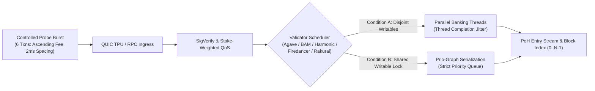

# Solana Validator Order (`solana-validator-order`)

[](https://github.com/jeffrey-graham/solana-validator-order/actions/workflows/ci.yml)
[](https://jeffrey-graham.github.io/solana-validator-order/)
[](LICENSE)

An open-source empirical measurement suite, **Python & TypeScript priority-fee SDK**, **Solana SBF on-chain registry program**, and **live browser terminal** for pricing writable-account lock contention and verifying validator transaction ordering across post-Alpenglow Solana Mainnet clients (**Agave**, **AgaveBam**, **JitoLabs**, **HarmonicAgave**, **Rakurai**, **Firedancer**, **HarmonicFiredancer**, and **FireBAM**).

* **Live Interactive Demo:** [https://jeffrey-graham.github.io/solana-validator-order/](https://jeffrey-graham.github.io/solana-validator-order/)
  * Live 150-slot per-writable-account `P25 / P50 / P75 / P90 / P95` micro-lamport/CU estimator + 20-slot EMA surge detector + binary `ComputeBudget` hex builder.
  * Live Mainnet-Beta & Devnet Program ID verifier (`getAccountInfo`) + zero-SOL Devnet SVM `simulateTransaction` probe runner.
  * Interactive 16-block / 7,306-transaction Post-Alpenglow Mainnet validator scheduler explorer.
* **Full Empirical Report:** [`REPORT.md`](REPORT.md) (measurements recorded on Solana Mainnet-Beta post-Alpenglow upgrade).

---

## 1. Open-Source SDKs & CLI

Because Solana's Banking Stage (`prio-graph` in Agave, conflict matrix in Firedancer/Rakurai) serializes transactions **per contending writable account** rather than globally across a block, global fee averages routinely overpay on cold state or stall on hot AMM/router locks. Both SDKs query `getRecentPrioritizationFees` scoped to the exact writable accounts your transaction touches, detect recent 20-slot congestion surges, and emit ready-to-append `ComputeBudget` (`0x02` / `0x03`) instructions.

### Python SDK (`solana-validator-order`)

Zero external runtime dependencies (pure Python 3.10+ standard library):

```bash
pip install -e .

# Live per-writable-account priority-fee percentiles (e.g. Jupiter v6 + USDC)
solana-order-fee \
  --writable JUP6LkbZbjS1jKKwapdHNy74zcZ3tLUZoi5QNyVTaV4 \
  --writable EPjFWdd5AufqSSqeM2qN1xzybapC8G4wEGGkZwyTDt1v \
  --cu-limit 200000

# Live Mainnet-Beta + Devnet Program ID verification & Devnet SVM simulation
solana-order-verify
```

```python
from solana_validator_order import (
    SolanaPriorityFeeClient,
    encode_set_compute_unit_limit,
    encode_set_compute_unit_price,
)

client = SolanaPriorityFeeClient("https://solana-rpc.publicnode.com")
estimate = client.estimate_writable_lock_fees(
    writable_accounts=[
        "JUP6LkbZbjS1jKKwapdHNy74zcZ3tLUZoi5QNyVTaV4",
        "675kPX9MHTjS2zt1qfr1NYHuzeLXfQM9H24wFSUt1Mp8",
    ],
    cu_limit=200_000,
)

fast = estimate.recommendations["fast"]
print(f"Fast tier (P75 + surge guard): {fast.cu_price_micro_lamports:,} uLamports/CU")
print(f"Total landed fee @ 200k CU:    {fast.total_fee_lamports:,} lamports")

ix_limit = encode_set_compute_unit_limit(200_000)
ix_price = encode_set_compute_unit_price(fast.cu_price_micro_lamports)
```

### TypeScript / ESM SDK (`@jeffrey-graham/solana-validator-order`)

Zero external runtime dependencies (Node.js 18+ & modern browsers via native `fetch` + `.d.ts` typings):

```javascript
import {
  SolanaPriorityFeeClient,
  encodeSetComputeUnitLimit,
  encodeSetComputeUnitPrice,
} from "./sdk-ts/src/index.mjs";

const client = new SolanaPriorityFeeClient("https://solana-rpc.publicnode.com");
const est = await client.estimateWritableLockFees(
  ["JUP6LkbZbjS1jKKwapdHNy74zcZ3tLUZoi5QNyVTaV4"],
  { cuLimit: 200_000 },
);

const cuLimitIxData = encodeSetComputeUnitLimit(200_000);
const cuPriceIxData = encodeSetComputeUnitPrice(est.recommendations.fast.cuPriceMicroLamports);
```

---

## 2. On-Chain Program Architecture & Live Verification

| Program | Address (`Pubkey`) | Cluster Scope | Role in `solana-validator-order` |
| :--- | :--- | :--- | :--- |
| **Compute Budget** | `ComputeBudget111111111111111111111111111111` | Mainnet-Beta & Devnet (`NativeLoader`) | `SetComputeUnitLimit` (`0x02`) & `SetComputeUnitPrice` (`0x03`) fee bidding |
| **SPL Memo v2** | `MemoSq4gqABAXKb96qnH8TysNcWxMyWCqXgDLGmfcHr` | Mainnet-Beta & Devnet (`BPFLoader2`) | Deterministic burst sequence tagging & zero-SOL Devnet SVM execution simulation |
| **Jupiter Aggregator v6** | `JUP6LkbZbjS1jKKwapdHNy74zcZ3tLUZoi5QNyVTaV4` | Mainnet-Beta (`BPFLoaderUpgradeab1e`) | Benchmark high-contention router account lock |
| **Raydium Liquidity Pool v4** | `675kPX9MHTjS2zt1qfr1NYHuzeLXfQM9H24wFSUt1Mp8` | Mainnet-Beta (`BPFLoader2`) | Benchmark shared-writable AMM pool lock |
| **ValidatorOrderRegistry** | `CmNC6vKh7Tr99ucPJacvgibwVE4JgUhqunyQ3qeCm6Do` | Custom SBF Program (`programs/validator-order-registry`) | On-chain `RecordProbePulse` (`0x01`, `SVOR` 208B ring buffer) & `PublishFeeCheckpoint` (`0x02`, `SVFC` 112B state) |

### Building & Deploying `ValidatorOrderRegistry` (`CmNC6vKh7Tr99ucPJacvgibwVE4JgUhqunyQ3qeCm6Do`)

GitHub Actions CI compiles `programs/validator-order-registry` via `cargo build-sbf` on every push and uploads `validator_order_registry.so` as a build artifact. To deploy or verify against Solana Devnet (keeping keypairs strictly outside the repository):

```bash
# 1. Run live RPC verification across Mainnet-Beta & Devnet + Devnet SVM probe simulation
python3 -m solana_validator_order.program_verifier

# 2. Deploy compiled validator_order_registry.so to Devnet (requires ~0.5 Devnet SOL from https://faucet.solana.com)
python3 scripts/deploy_devnet_program.py \
  --so-path artifacts/validator_order_registry.so \
  --payer-keypair ~/.config/solana/devnet-deployer.json \
  --program-keypair ~/.config/solana/validator-order-program.json
```

---

## 3. Quick Start: Reproducing the Mainnet Measurement Suite

### Run Automated Tests (Python, TypeScript, and Rust)

```bash
# Python SDK, binary codecs, SpendGuard, post-Alpenglow v1 parser & Spearman math
python3 -m unittest discover -s tests -v

# TypeScript / ESM SDK tests
npm --prefix sdk-ts test

# Rust SBF program unit tests (when Rust toolchain is installed)
cargo test --manifest-path programs/validator-order-registry/Cargo.toml
```

### Run Mainnet Block Probe & Verification (Docker or Direct Python)

By default, `src/probe.py` runs in **safe `--dry-run` mode** (zero SOL spent, no private key required), builds and validates controlled probe bursts under `SpendGuard`, fetches and analyzes live post-Alpenglow Mainnet blocks across 8 validators, and writes the raw dataset to [`data/raw_measurements.json`](data/raw_measurements.json):

```bash
# Option A: Docker Compose
docker compose up --build probe
docker compose run --rm verify
docker compose run --rm test

# Option B: Direct Python 3.10+ (zero external dependencies)
python3 src/probe.py --max-spend-sol 0.02 --blocks-per-validator 2
python3 src/verify_claims.py
```

To execute live probe bursts into target validator leader windows with a hard spend cap (enforced in code at $\le 0.05\text{ SOL}$, keys mounted outside the repo):

```bash
HOST_KEYPAIR_DIR=/path/to/keydir SOLANA_KEYPAIR_PATH=/keys/id.json \
  docker compose run --rm probe --live --max-spend-sol 0.02 --blocks-per-validator 2
```

---

## 4. Experimental Design & Methodology

### Disentangling the Three Forces Inside a Solana Block

Measuring transaction ordering on Solana Mainnet requires separating three simultaneous forces that determine a transaction's final `block_index` ($0 \dots N-1$):

1. **The Scheduler's Priority Formula:** In Anza Agave (`core/src/banking_stage/transaction_scheduler/prio_graph_scheduler.rs`), priority is calculated as:
   $$\text{Score} = \frac{\text{Total Fee (Base Fee + Priority Fee)}}{\text{Requested Compute Units } (CU_{\text{req}}) + 1}$$
2. **Account Write-Lock Contention vs. Multi-Thread Parallelism:** Non-conflicting transactions touching disjoint accounts are dispatched concurrently across multiple banking worker threads (`bank` tiles in Firedancer) and recorded into PoH entries as threads complete. By contrast, transactions locking the **same writable account** are serialized inside the scheduler's dependency graph (`prio-graph` in Agave, conflict matrix in Firedancer/Rakurai).
3. **Continuous PoH Streaming vs. Sub-Slot Micro-Batch Buffering:** Because Solana streams entries continuously across 64 PoH ticks (~400ms per slot), a high-fee transaction arriving at $t = 300\text{ ms}$ cannot jump ahead of a low-fee transaction already broadcast in an entry at $t = 50\text{ ms}$ *unless* the validator fork buffers incoming transactions into sub-slot auction windows (e.g., BAM, Harmonic, or Jito bundle windows).



### Accounting for the 6 Core Confounders

| Confounder | How Our Design Accounts for It |
| :--- | :--- |
| **1. Leader Schedule & Leader Types** | `discover_diverse_validators()` cross-references Stakewiz validator telemetry with live `getClusterNodes` and `getSlotLeaders` RPC calls to select **8 active Mainnet validators spanning 7 distinct client/fork configurations**: `AgaveBam 4.3.2`, `JitoLabs 4.3.2`, `HarmonicAgave 4.3.2`, `HarmonicFiredancer 26.10.4`, `Firedancer 26.10.4`, `Rakurai 4.3.2`, `FireBAM 26.10.4`, and Vanilla non-Jito `Agave 4.3.2`. Every measured block is tagged with its rotational position inside the 4-slot leader window (`window_slot_offset = slot % 4`, contrasting mid-window `offset 2` vs end-of-window `offset 3`). |
| **2. Transaction Path (Backend $\to$ Executing Node)** | Transactions traverse sender $\to$ RPC/TPU forwarder $\to$ QUIC stake-weighted QoS stream $\to$ `sigverify` $\to$ scheduler buffer. All 6 probe transactions in a burst share identical instruction structure (`ComputeBudget` + 0-lamport `System::Transfer` write-lock + `Memo`) and identical `600 CU` limits. |
| **3. Interaction of Our Own Transactions** | Every target validator window is tested with **two orthogonal 6-transaction burst conditions**:<br>• **Condition A (`INDEPENDENT_LANES`):** Each transaction write-locks a distinct derived account (`ind-lock-{validator}-{seq}`), allowing parallel scheduling across worker threads.<br>• **Condition B (`SHARED_WRITABLE_CONTENTION`):** All 6 transactions write-lock the **same shared account** (`shared-lock-{validator}`), forcing serialization inside a single conflict queue. |
| **4. Competition Inside the Block & Jito Separation** | Jito bundles/tips are separated from native scheduler ordering: `block_parser.py` identifies transactions touching any of the 8 canonical Jito tip accounts (`96gYZGLn...`, `HFqU5x63...`, etc.) and excludes them (`is_jito_tip == False`) when computing native scheduler correlation metrics, while `analyze_contending_queues()` measures background writable-account contention. |
| **5. Send Order vs. Priority Fee** | In each 6-transaction burst, transactions are dispatched in **strictly ascending priority-fee order** (`1,000` $\to$ `5,000` $\to$ `15,000` $\to$ `45,000` $\to$ `120,000` $\to$ `300,000` $\mu\text{lamports/CU}$, spaced by 2ms). Send order rank ($+1.0$) is the exact inverse of priority rank ($-1.0$): Spearman $\rho \approx +1.0$ indicates arrival-time FIFO; $\rho \approx -1.0$ proves priority re-ordering. |
| **6. Noise vs. Rule** | Computes non-parametric **Spearman rank correlation ($\rho$)** against four candidate formulas (`scheduler_priority_score = total_fee / CU_req`, `priority_fee / CU_req`, `priority_fee / CU_used`, and `raw_total_fee`), pairwise descending monotonicity rate, and quartile median profiles (`Q1..Q4`). |

---

## 5. Repository Structure

* [`src/solana_validator_order/`](src/solana_validator_order/) — Installable Python SDK (`fee_estimator.py`, `registry_client.py`, `program_verifier.py`) & CLI entrypoints.
* [`sdk-ts/`](sdk-ts/) — Zero-dependency TypeScript / ESM SDK (`@jeffrey-graham/solana-validator-order`) with `.d.ts` definitions and `node --test` suite.
* [`programs/validator-order-registry/`](programs/validator-order-registry/) — Native Rust Solana SBF program (`CmNC6vKh7Tr99ucPJacvgibwVE4JgUhqunyQ3qeCm6Do`) recording on-chain burst reorderings and fee checkpoints.
* [`docs/`](docs/) — Standalone live interactive web terminal served via GitHub Pages.
* [`scripts/deploy_devnet_program.py`](scripts/deploy_devnet_program.py) — Pure-Python Ed25519 Solana Devnet `BPFLoader2` deployer & verifier.
* [`src/probe.py`](src/probe.py), [`src/block_parser.py`](src/block_parser.py), [`src/analyzer.py`](src/analyzer.py), [`src/verify_claims.py`](src/verify_claims.py) — Empirical post-Alpenglow Mainnet block measurement & verification pipeline.
* [`tests/`](tests/) — Automated unit & codec test suites (`test_pipeline.py`, `test_sdk_and_registry.py`).
* [`data/raw_measurements.json`](data/raw_measurements.json) & [`REPORT.md`](REPORT.md) — Raw 16-block Mainnet dataset (7,306 transactions) and complete empirical write-up.

## License

Released under the [MIT License](LICENSE).
