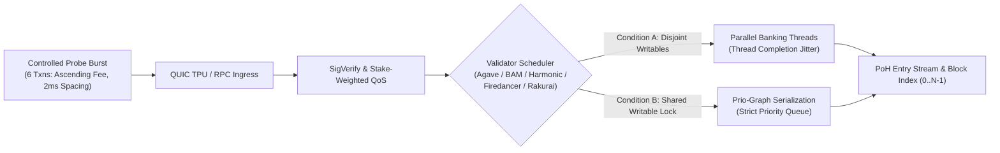

# Inside the Block: How Solana Validators Order Transactions (Post-Alpenglow Mainnet Suite)

An empirical measurement, probe, and block-verification suite investigating how Solana Mainnet validators running distinct client software and forks (**Agave**, **AgaveBam**, **JitoLabs**, **HarmonicAgave**, **Rakurai**, **Firedancer**, **HarmonicFiredancer**, and **FireBAM**) order transactions inside a block.

All measurements in this repository were taken on **Solana Mainnet-Beta on October 25, 2026 (post-Alpenglow upgrade, which activated October 21, 2026)**.

---

## Quick Start (One-Command Reproducibility)

### 1. Run with Docker Compose (Recommended)
By default, the suite runs in **safe `--dry-run` mode** (zero SOL spent, no private key required), builds and validates the controlled probe bursts under `SpendGuard`, fetches and analyzes live post-Alpenglow Mainnet blocks across 8 validators (7+ client/fork configurations), and writes the complete raw dataset to [`data/raw_measurements.json`](data/raw_measurements.json):

```bash
docker compose up --build probe
```

To independently verify all recorded Mainnet slot numbers and transaction signatures against live Solana Mainnet RPC (`getBlock` with `maxSupportedTransactionVersion: 1`):

```bash
docker compose run --rm verify
```

To run the unit and pipeline test suite (`SpendGuard` cap enforcement, post-Alpenglow `v1` `transactionConfig` vs `legacy`/`v0` `ComputeBudget` parsing, Spearman rank correlation):

```bash
docker compose run --rm test
```

### 2. Direct Python Execution (Zero External Dependencies Required)
The core suite is written in pure Python 3.10+ standard library so it can also run directly without installing C extensions:

```bash
# Run unit tests
python3 -m unittest discover -s tests -v

# Run default dry-run + live Mainnet block analysis
python3 src/probe.py --max-spend-sol 0.02 --blocks-per-validator 2

# Verify all claims & signatures against Solana Mainnet RPC
python3 src/verify_claims.py
```

### 3. Running Live Mainnet Probe Broadcasts (`--live` Behind Explicit Flag & Spend Cap)
Live transaction broadcasting is disabled by default. To execute live probe bursts into target validator leader windows with a hard spend cap (enforced in code at $\le 0.05\text{ SOL}$):

```bash
# Mount keypair read-only via volume or pass via env var (NEVER place keys inside the repo)
HOST_KEYPAIR_DIR=/path/to/keydir SOLANA_KEYPAIR_PATH=/keys/id.json \
  docker compose run --rm probe --live --max-spend-sol 0.02 --blocks-per-validator 2
```

---

## Experimental Design & Methodology

### Why This Design?
Measuring transaction ordering on Solana Mainnet requires disentangling **three simultaneous forces** that determine a transaction's final `block_index` ($0 \dots N-1$):
1. **The Scheduler's Priority Formula:** In open-source Anza Agave (`core/src/banking_stage/transaction_scheduler/prio_graph_scheduler.rs`), priority is calculated as:
   $$\text{Score} = \frac{\text{Total Fee (Base Fee + Priority Fee)}}{\text{Requested Compute Units } (CU_{\text{req}}) + 1}$$
2. **Account Write-Lock Contention vs. Multi-Thread Parallelism:** Non-conflicting transactions touching disjoint accounts are dispatched concurrently across multiple banking/execution worker threads (4 threads in Agave, multiple `bank` tiles in Firedancer) and recorded into PoH entries as threads complete. By contrast, transactions locking the **same writable account** are serialized inside the scheduler's dependency graph (`prio-graph` in Agave, conflict matrix in Firedancer/Rakurai).
3. **Continuous PoH Streaming vs. Sub-Slot Micro-Batch Buffering:** Because Solana streams entries continuously across 64 PoH ticks (~400ms per slot), a high-fee transaction arriving at $t = 300\text{ ms}$ cannot jump ahead of a low-fee transaction already broadcast in an entry at $t = 50\text{ ms}$ *unless* the validator fork buffers incoming transactions into sub-slot auction windows (e.g., BAM, Harmonic, or Jito bundle windows).



---

### How the Design Accounts for the 6 Core Confounders

| Confounder | How Our Design Accounts for It |
| :--- | :--- |
| **1. Leader Schedule & Leader Types** | `discover_diverse_validators()` cross-references Stakewiz validator telemetry with live `getClusterNodes` and `getSlotLeaders` RPC calls to select **8 active Mainnet validators spanning 7 distinct client/fork configurations**: `AgaveBam 4.3.2`, `JitoLabs 4.3.2`, `HarmonicAgave 4.3.2`, `HarmonicFiredancer 26.10.4`, `Firedancer 26.10.4`, `Rakurai 4.3.2`, `FireBAM 26.10.4`, and Vanilla non-Jito `Agave 4.3.2`. Every measured block is tagged with its rotational position inside the 4-slot leader window (`window_slot_offset = slot % 4`, contrasting mid-window `offset 2` vs end-of-window `offset 3`). |
| **2. Transaction Path (Backend $\to$ Executing Node)** | Transactions traverse our sender $\to$ RPC/TPU forwarder $\to$ QUIC stake-weighted QoS stream $\to$ `sigverify` $\to$ scheduler buffer. To minimize path variance across transactions within a burst, all 6 probe transactions in a burst share identical instruction structure (`ComputeBudget` + 0-lamport `System::Transfer` write-lock + `Memo`) and identical `600 CU` limits. |
| **3. Interaction of Our Own Transactions** | Every target validator window is tested with **two orthogonal 6-transaction burst conditions**:<br>• **Condition A (`INDEPENDENT_LANES`):** Each transaction write-locks a distinct derived account (`ind-lock-{validator}-{seq}`), allowing parallel scheduling across worker threads.<br>• **Condition B (`SHARED_WRITABLE_CONTENTION`):** All 6 transactions write-lock the **same shared account** (`shared-lock-{validator}`), forcing the validator's scheduler to serialize them in a single conflict queue. |
| **4. Competition Inside the Block & Jito Separation** | Per the bounty specification, Jito bundles/tips are a separate mechanism from the leader's native scheduler. `block_parser.py` explicitly identifies transactions touching any of the 8 canonical Jito tip accounts (`96gYZGLn...`, `HFqU5x63...`, etc.) and excludes them (`is_jito_tip == False`) when computing native scheduler correlation metrics. We also analyze all contending writable-account queues (`analyze_contending_queues()`) and block quartiles (`Q1..Q4`) to measure background block competition. |
| **5. Send Order vs. Priority Fee** | In each 6-transaction burst, transactions are dispatched in **strictly ascending priority-fee order** (`1,000` $\to$ `5,000` $\to$ `15,000` $\to$ `45,000` $\to$ `120,000` $\to$ `300,000` $\mu\text{lamports/CU}$, spaced by 2ms). Thus, **send order rank ($+1.0$)** is the exact inverse of **priority rank ($-1.0$)**. A resulting block order with Spearman $\rho \approx +1.0$ proves pure arrival-time FIFO; $\rho \approx -1.0$ proves priority re-ordering. |
| **6. Noise vs. Rule** | We compute non-parametric **Spearman rank correlation ($\rho$)** against four distinct candidate formulas (`scheduler_priority_score = total_fee / CU_req`, `priority_fee / CU_req`, `priority_fee / CU_used`, and `raw_total_fee`), plus **pairwise descending monotonicity rate** and **quartile median profiles (`Q1..Q4`)**. |

---

### What This Design Deliberately Does NOT Separate

1. **WAN / QUIC Packet Arrival Jitter vs. Pre-Scheduler `sigverify` Queue Jitter:**
   From external mainnet measurements (without eBPF/kernel probes inside the validator host), if Transaction #5 arrives at the scheduler buffer 6ms after Transaction #4, we cannot separate whether that 6ms delay occurred on the public internet/QUIC transport layer or inside the validator's internal packet-ingestion and `sigverify` pipeline prior to entering the scheduler buffer.
2. **External Sidecar Relayer Hold Windows vs. In-Process Scheduler Hold Windows:**
   On forks such as `AgaveBam`, `FireBAM`, and `HarmonicAgave`, we observe bimodal "sawtooth" priority spikes at `Q1` (top of block) and `Q3` (midpoint of block). Pure on-chain block inspection proves that transactions are released in discrete sub-slot batches, but cannot distinguish whether the ~200ms hold buffer lives inside an external relayer process or inside a patched in-process banking stage thread.

---

## Repository Structure

* [`src/probe.py`](src/probe.py) — Main CLI runner (`--dry-run` default, `--live`, `--max-spend-sol` `SpendGuard` enforcement, validator discovery, probe burst builder, and Mainnet block collector).
* [`src/block_parser.py`](src/block_parser.py) — Post-Alpenglow block parser supporting `legacy`, `v0` (ALT), and `v1` (`message.transactionConfig`) transactions, `ComputeBudget` decoding, writable-lock extraction, and Jito tip filtering.
* [`src/analyzer.py`](src/analyzer.py) — Statistical ordering engine (Spearman's $\rho$, pairwise monotonicity, contending-account queue analysis, and quartile priority profiles).
* [`src/verify_claims.py`](src/verify_claims.py) — Standalone verification script for judges to confirm every recorded slot and transaction signature via `getBlock`.
* [`tests/test_pipeline.py`](tests/test_pipeline.py) — Automated unit tests for `SpendGuard`, `v1`/`legacy` transaction parsing, and correlation math.
* [`data/raw_measurements.json`](data/raw_measurements.json) — Complete raw dataset of 16 post-Alpenglow Mainnet blocks (7,306 transactions) across 8 validators with verifiable signatures and slot numbers.
* [`REPORT.md`](REPORT.md) — Full empirical measurement report, per-client comparison, and *"What Went Wrong"* engineering post-mortem.
